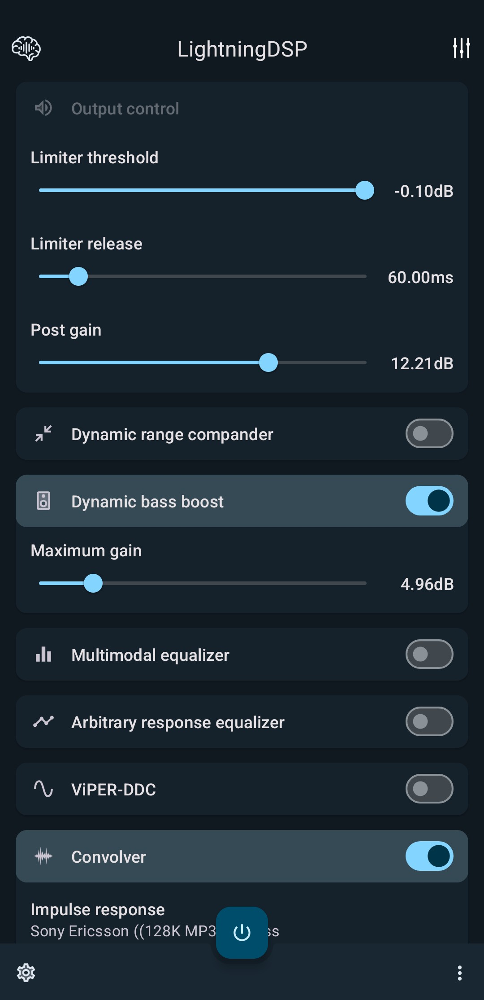
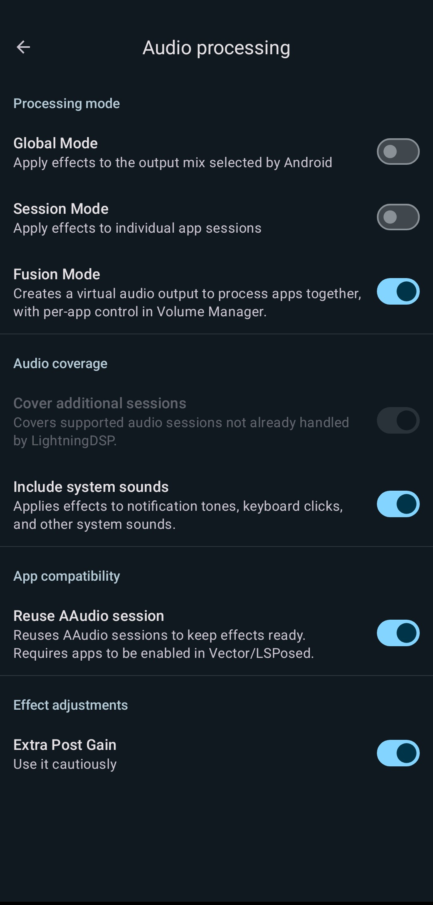
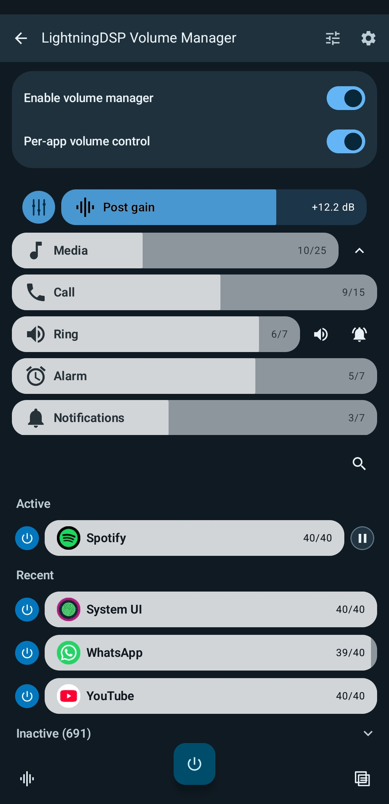
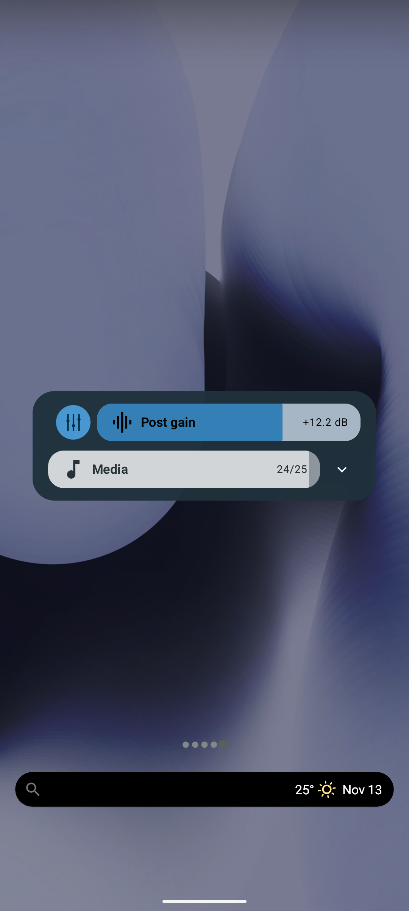
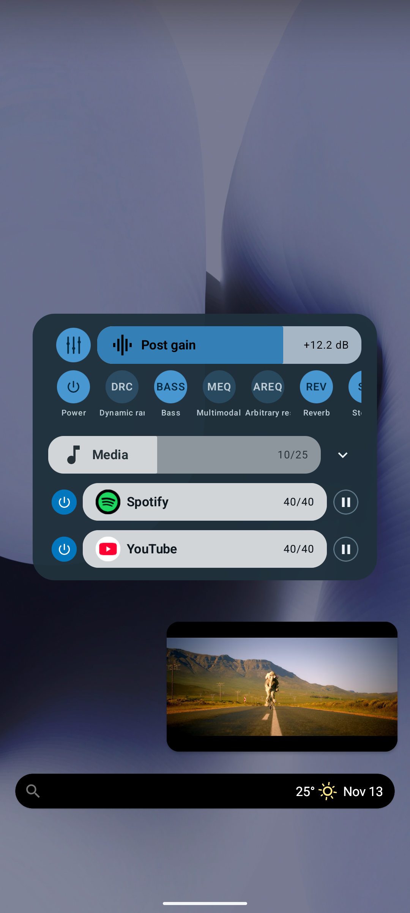
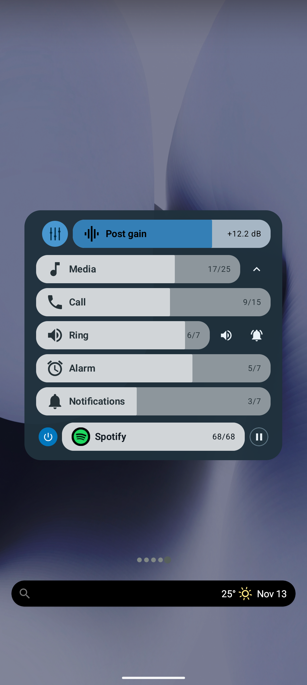

# LightningDSP

**Your music, with a little more say in how it sounds.**

<table>
  <tr>
    <td width="33%" align="center"></td>
    <td width="33%" align="center"></td>
    <td width="33%" align="center"></td>
  </tr>
  <tr>
    <td width="33%" align="center"></td>
    <td width="33%" align="center"></td>
    <td width="33%" align="center"></td>
  </tr>
</table>

This is LightningDSP, your audio pocket knife for Android. It is a root audio-effects module, a companion app, and a collection of tools for shaping sound and controlling volume. Keep your favorite music player. LightningDSP works alongside it.

The current stable releases are **LightningDSP module 6.7** and **LightningDSP app 1.7**. The module includes the signed root app. You can also download the APK separately, but the APK alone does not install the audio driver.

[Download the module](https://github.com/zahahah/LightningDSP/releases/tag/v6.7) · [App source and release](https://github.com/zahahah/LightningDSP-App) · [Native library source](https://github.com/zahahah/LibLightningDSP-OSS)

The main branch has newer features, including **Fusion Mode**. They are not part of
stable 6.7 yet. Test builds are available in [module Actions](https://github.com/zahahah/LightningDSP/actions/workflows/main-module-artifacts.yml)
and [app Actions](https://github.com/zahahah/LightningDSP-App/actions/workflows/root-artifacts.yml).

## Make the sound yours

LightningDSP gives you more than a few bass and treble sliders:

- **FIR and IIR equalization** for shaping the frequency response.
- **Convolution and DDC/VDC correction** for impulse responses and compatible headphone profiles.
- **Dynamics and output controls** including compander, limiter and post-gain.
- **Crossfeed, stereo enhancement, bass boost, reverb and tube-style effects** for different listening preferences.
- **Live Programmable DSP** for your own EEL scripts.

It's a collection of tools, not a preset that automatically makes everything sound better. Start with a small adjustment, listen at a comfortable volume, and keep what works for you.

### Pick how to process audio

- **Global Mode** applies effects to the output mix selected by Android.
- **Session Mode** applies effects to individual audio sessions. Media session
  scanning helps find apps that do not announce their sessions.
- **Fusion Mode** creates a virtual audio output and processes apps together.
  Use the DSP power buttons in Volume Manager to leave an app without effects.
  Fusion needs root, not Vector/LSPosed. The extra audio path can add latency.

On current main-branch builds, new root installations start with Fusion Mode,
Volume Manager, app DSP buttons and media controls enabled. Your saved choices
stay as they are. Global Mode cannot exclude one app from its shared effect;
per-app DSP buttons work in Session Mode and Fusion Mode.

**Include system sounds** extends Session/Fusion coverage to eligible keyboard,
notification and system audio.

For apps that still miss effects in Global or Session Mode, **Cover additional
sessions** and the opt-in compatibility hook offer other paths. **Improve app
compatibility** supports tested FAST-requesting emulators, including Bannerlator,
Eden, NetherSX2, ARMSX2 and RetroArch. Select affected apps in Vector/LSPosed and
restart them. **Reuse AAudio session** is a separate option for scoped apps that
create a new session for each sound. These hooks are not required for Fusion.

### LightningDSP Volume Manager

A per-app volume manager inspired by the VolumeManager app. It is part of the root app, not a separate installation. Open it from the mixer button on the main screen. Stable 6.7 leaves it off by default; the current main-branch defaults are described above.

Control each app's volume, mute and stereo balance, including saved settings for apps that are not playing right now. See Active, Recent and Inactive apps; pin, hide and reorder them. The manager also includes system streams, a LightningDSP effects card, a floating panel, themes, and backup and restore of portable settings. In the floating panel, tap the LightningDSP card icon to open its effect controls. Press and hold an effect name to select it, then use the slider to lower or raise its intensity. The per-app controls and DSP card have separate switches.

Show play/pause buttons for players that expose media controls. Pause from our
panel and the app stays there for up to three minutes so you can resume it;
pausing elsewhere does not start that timer. Notification access is set up with
root when needed. DSP buttons can stay visible or appear when you tap the
LightningDSP icon, but only while their setting is enabled.

Edit mode lets you save or cancel your changes. Hide an app from the floating
panel separately from hiding it in the manager. Inactive apps can be collapsed,
and **Hide system apps** filters only the manager page, not the floating panel.
Samsung stock-panel handling and KDE Connect remote-volume recovery have also
received fixes; behavior still depends on the device firmware.

An optional **Disable App Audio Focus (Requires Xposed)** setting is available only after LightningDSP verifies its active System Framework hook. It does not change system files. **Extra Post Gain** is a separate, off-by-default setting under Audio processing.

## Get started

1. Download the [LightningDSP 6.7 ZIP](https://github.com/zahahah/LightningDSP/releases/tag/v6.7) and install it with a compatible root manager. The module is root-only and includes an ARM64 audio-effect driver. On KernelSU, you also need a mounting metamodule, such as **Magic Mount** or **NoMount**.
2. Follow your root manager's activation or reboot procedure. Temp-root/late-load setups need their own activation flow; a reboot may not preserve temp root.
3. Open LightningDSP and grant **the app itself** root access. Root granted to ADB or another app is not a grant to LightningDSP.
4. Enable processing, play music, and try an obvious EQ adjustment at a comfortable volume.

The module installs its library and effect configuration systemlessly. It does not permanently rewrite your system or vendor partitions. Device firmware, effect host, root mounts and audio route still affect compatibility. The native library supports Android's AIDL effect entry and a legacy effect entry in one ARM64 binary; the app keeps the AudioEffect lifecycle and uses native control where supported.

The installer creates `/sdcard/LightningDSP/Presets` alongside the public effect examples. The app keeps its live preset library separately in its app-specific storage, normally `Android/data/com.lightning.dsp/files/Presets`. Use the app's preset import/export controls to move presets between locations.

### Keeping up to date

The current main-branch app can check for new **stable module releases**, not
pre-releases or app-only releases. **Download** opens the release page; **Skip**
hides just that version. You can turn off automatic checks in Settings. KernelSU
Manager uses the same stable module update channel, not the Actions test builds.

### Coming from JamesDSP?

This project continues my JamesDSP-based work under the LightningDSP name. The last pre-rebrand stable releases remain available as [JamesDSPManager-Classic 6.6](https://github.com/zahahah/JamesDSPManager-Classic/releases/tag/v6.6) and [RootJamesDSP-Classic 1.6.17](https://github.com/zahahah/RootJamesDSP-Classic/releases/tag/v1.6.17).

During an **explicit module flash**, the installer verifies the old `ainur_jamesdsp` identity, marks that module disabled, and removes its directory before installing LightningDSP. It removes the old `james.dsp` app and installs `com.lightning.dsp`. Those are different Android packages: private app data is not migrated, so export presets you want to keep first. Updating an existing `com.lightning.dsp` with the same certificate preserves its data; a certificate mismatch still uses the existing confirmation and best-effort backup flow. Boot does not silently uninstall apps, and removing the module does not remove the LightningDSP app.

## If something doesn't work

Tell me your device and Android build, root manager, module and app versions, audio route, and whether you used normal boot or late-load. Other audio modules can matter too. For native-path diagnostics, mounting, lifecycle and control details, see [LIGHTNINGDSP-CONTROL.md](LIGHTNINGDSP-CONTROL.md) and [TEMP-ROOT-RELOAD.md](TEMP-ROOT-RELOAD.md). The [changelog](changelog.md) records release changes.

## Roadmap

I am considering script-level debugging tools for Live Programmable DSP, an optional SBC XQ Bluetooth audio-stack patch for compatible devices, and a Loudness Controller inspired by existing rootless JamesDSP implementations. These are ideas, not features included in 6.7.

## Credits and licensing

LightningDSP is based on JamesDSP. Renaming my maintained project does not replace the people who built its foundations or their licenses. Thank you to [James Fung (james34602)](https://github.com/james34602/JamesDSPManager), [ThePBone](https://github.com/ThePBone/RootlessJamesDSP), the [original JamesDSPManager module](https://github.com/therealahrion/JamesDSPManager), [ShadoV90](https://github.com/ShadoV90/JamesDSPManager), zackptg5, ahrion and anonymix007, alongside the contributors credited in those projects.

The native library's GPL-2.0 license is included in [native-control/LightningDSP-Main-LICENSE.txt](native-control/LightningDSP-Main-LICENSE.txt). Other notices and attribution remain in the source and companion repositories. The [Classic repositories](https://github.com/zahahah/JamesDSPManager-Classic) preserve the pre-rebrand releases and history.
